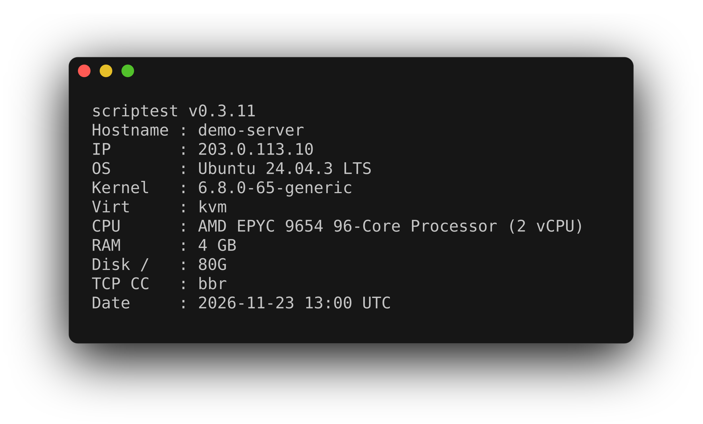
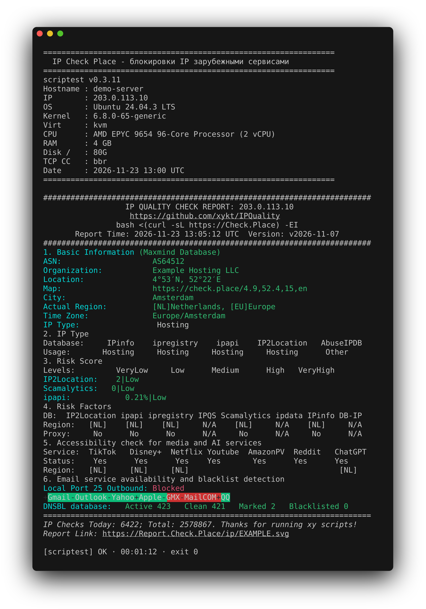
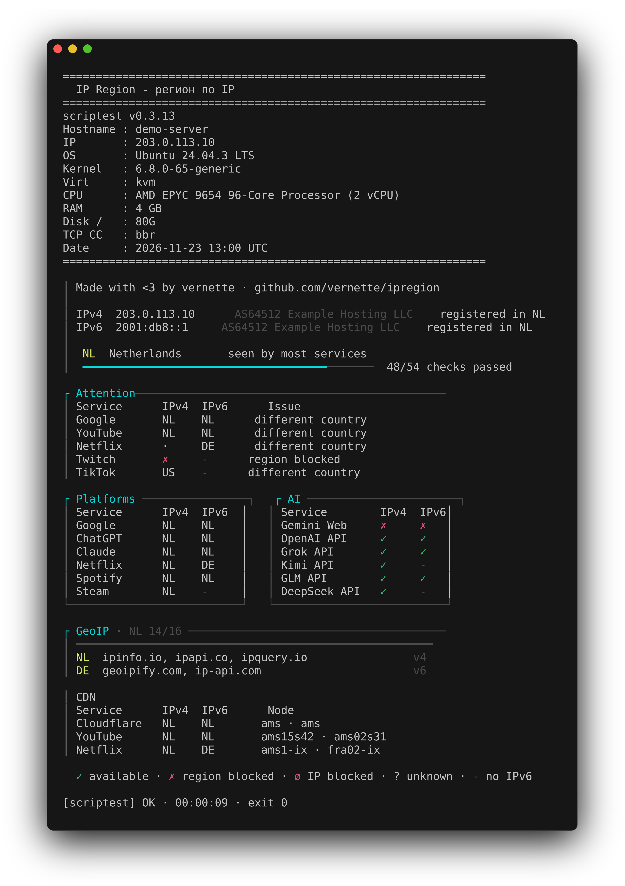
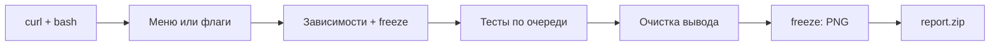

<div align="center">

```text
   ██████╗█████╗█████╗ ██╗█████╗ ███████╗██████╗██████▐██████╗
   ██╔═══██╔═══╝██╔═██╗██║██╔═██╗╚═██╔══╝██╔═══╝██╔═══╚═██╔══╝
  ██████▐█║    █████╔╝██║█████╔╝  ██║   ████╗  ██████╗ ██║
  ╚═══██▐█║    ██╔═██╗██║██╔══╝   ██║   ██╔═╝  ╚═══██║ ██║
  ██████╚█████╗██║ ██║██║██║      ██║   ██████║██████║ ██║
  ╚═════╝╚════╝╚═╝ ╚═╝╚═╝╚═╝      ╚═╝   ╚═════╝╚═════╝ ╚═╝
```

### Мульти-тест сервера с красивыми скриншотами

Один файл, ноль установки. Кинул на сервер, выбрал тесты, забрал ZIP с картинками.

[](https://github.com/pashtetusss777/scriptest/actions/workflows/smoke.yml)


</div>

---

## Быстрый старт

Зайди на сервер по SSH и выполни одну команду:

```bash
bash <(curl -sL https://raw.githubusercontent.com/pashtetusss777/scriptest/main/scriptest.sh)
```

Откроется меню: цифры через запятую выбирают тесты, `a` запускает всё, `u` открывает сетевые утилиты. Можно и без меню:

```bash
curl -sL https://raw.githubusercontent.com/pashtetusss777/scriptest/main/scriptest.sh -o scriptest.sh
bash scriptest.sh --only sysbench,ipregion
```

Нужны root или `sudo`: часть тестов и настройка BBR требуют прав.

## Что получается на выходе

Скрипт пишет логи с цветом и превращает их в PNG через [freeze](https://github.com/charmbracelet/freeze). Вот так выглядят отчёты (данные с демо-сервера):

| Шапка сервера | Блокировки IP |
|---|---|
|  |  |



В конце собирается `report.zip`, внутри только PNG. Имя занято? Скрипт возьмёт `report-2.zip` и так далее. Рядом с картинками остаются текстовые логи и `summary.md` со статусами и временем тестов.

## Как это работает



- Скрипт сам определяет дистрибутив и ставит недостающие зависимости.
- Каждый тест пишет во временный файл, вывод чистится: спиннеры, стёртые баннеры и мусорные управляющие коды в отчёт не попадают, а цвета сохраняются.
- Живой тест с настоящими данными расходует трафик, поэтому перед полным прогоном скрипт всегда переспрашивает.
- Ничего никуда не загружается: все отчёты остаются на сервере.

## Тесты

| # | Тест | Что проверяет |
|---|------|---------------|
| 1 | sysbench | Процессор (`sysbench cpu run --threads=1`), чтобы понять % выделенного CPU |
| 2 | ipcheck | Блокировки IP зарубежными сервисами ([IP.Check.Place](https://ip.check.place)) |
| 3 | ipregion | Какой регион видят сайты по IP |
| 4 | dpi | Блокировка по DPI (для российских серверов) |
| 5 | insta | Блокировка аудио в Instagram |
| 6 | speed-ru | Скорость к российским провайдерам (bench.tlab.pw) |
| 7 | speed-world | Скорость к зарубежным провайдерам (bench.sh, резерв speed.tlab.pw) |
| 8 | yabs | Диск, сеть iperf3, GeekBench ([YABS](https://yabs.sh)) |
| 9 | geocheck | [GeoCheck](https://geocheck.ing). Только по выбору: номер в меню или `--only geocheck`, в полный прогон не входит |

## Утилиты: BBR и IPv6

Пункт `u` в меню.

- **BBR + Cake** включается навсегда: настройки пишутся в `/etc/sysctl.d/99-scriptest-bbr.conf`, их применяет `systemd-sysctl` при каждой загрузке. Прежние значения запоминаются, поэтому BBR можно так же аккуратно выключить. Если cake в ядре нет, скрипт честно оставит `fq_codel` и предупредит.
- **IPv6** отключается только до перезагрузки и никогда не трогается автоматически. Из IPv6 SSH-сессии скрипт откажется это делать: иначе можно выкинуть себя с сервера. Всё равно держи под рукой доступ по IPv4 или консоль.

Перед полным прогоном скрипт предложит включить BBR. Ответ по умолчанию: **нет**. При запуске `--all` без терминала настройки TCP не меняются вовсе.

## Флаги

| Флаг | Что делает |
|------|------------|
| `-a`, `--all` | Запустить все тесты (в терминале спросит про BBR) |
| `-o`, `--only <ids>` | Только выбранные тесты, например `--only sysbench,yabs` |
| `-s`, `--skip <ids>` | Пропустить тесты, например `--skip yabs,speed-world` |
| `-l`, `--list` | Показать список тестов |
| `-t`, `--theme dark\\|light` | Тема скриншотов, по умолчанию dark |
| `--no-png` | Без скриншотов |
| `--no-zip` | Без zip-архива |
| `--workdir <dir>` | Новая или пустая папка для отчёта |
| `-h`, `--help` | Справка |
| `-v`, `--version` | Версия |

Пример: быстрый тест CPU и IP-блокировок без YABS:

```bash
bash scriptest.sh -o sysbench,ipcheck,ipregion
```

## Как забрать результаты

После тестов скрипт покажет путь к архиву и готовую команду:

```bash
scp user@SERVER:/root/report.zip .
```

С `--no-zip` останется папка отчёта со всеми файлами, с `--no-png` только текстовые логи.

Перед публикацией отчёта проверь, не попали ли в скриншоты IP сервера и название организации.

## Поддерживаемые ОС

Ubuntu, Debian, AlmaLinux, Rocky Linux, CentOS, Fedora, RHEL, Arch, openSUSE, Alpine. Архитектуры: x86_64 и arm64.

При запуске через пайп меню читает выбор из SSH-терминала без повторной загрузки скрипта. Совсем без терминала передай аргументы: `curl -sL ... | bash -s -- --only sysbench`.

## Для разработчиков

```bash
bash -n scriptest.sh      # синтаксис
bash tests/smoke.sh       # дымовые тесты, нужен Linux
```

CI на каждый пуш гоняет оба шага на ubuntu-latest: меню, обработку Ctrl+C, рендер PNG, ZIP и проверку BBR на функциях-заглушках, так что реальный `sysctl` не трогается.

## Ограничения

- `sysbench` в Arch ставится только из AUR, поэтому тест процессора там пропустится.
- Если freeze упадёт на каком-то логе, скрипт оставит `.txt` и предупредит: пустых картинок в отчёте не бывает.
- Отключение IPv6 живет до перезагрузки: это осознанный выбор, чтобы не отрезать сервер от сети навсегда.

## Лицензия

MIT
